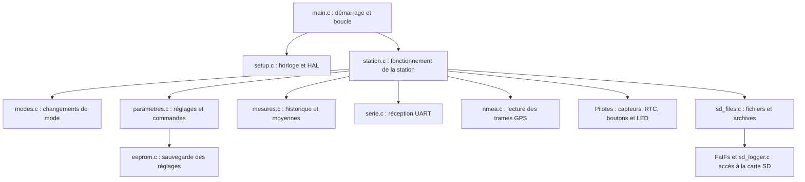

# Livrable 2 - Architecture du programme

Projet Worldwide Weather Watcher — Station météo sur STM32 Nucleo L476RG

## Organisation générale

Nous avons choisi de séparer le programme en plusieurs fichiers C. Chaque fichier a un rôle précis : lire les capteurs, gérer les modes, traiter les commandes ou enregistrer les mesures. Cela nous permet de travailler sur une partie du programme sans devoir modifier toute la boucle principale.

Nous partons de l'architecture fournie pour le projet. Les pilotes servent à communiquer avec les composants ; nos fonctions utilisent ces pilotes pour faire fonctionner la station.

## Rôle des fichiers et fonctions principales

| Fichier | Rôle | Fonctions principales |
|---|---|---|
| `main.c` | Initialiser la carte, puis appeler la boucle de la station | `main` |
| `setup.c` | Configurer l'horloge et les périphériques de la carte | Fonctions d'initialisation HAL |
| `station.c` | Relier les différentes parties du programme et gérer les acquisitions | `station_init`, `station_boucle` |
| `modes.c` | Choisir le prochain mode selon le bouton utilisé et le mode actuel | `mode_apres_appui` |
| `parametres.c` | Définir les valeurs par défaut et vérifier les commandes, la date et l'heure | `parametres_defaut`, `parametres_modifier`, `parametres_valides`, `regler_rtc` |
| `eeprom.c` | Charger et sauvegarder les paramètres, avec deux copies et un contrôle de validité | `parametres_charger`, `parametres_sauver` |
| `mesures.c` | Conserver les dernières mesures, calculer leur moyenne et compter les erreurs | `mesure_ajouter`, `mesure_moyenne`, `mesure_echouer` |
| `serie.c` | Recevoir les octets de la console et du GPS | `serie_init`, `serie_lire`, `serie_debordement` |
| `nmea.c` | Vérifier une trame GPS avant d'utiliser la position | `nmea_gga` |
| `sd_files.c` | Enregistrer les lignes de mesures et archiver les fichiers pleins | `SDLogger_Mount`, `SDLogger_Append`, `SDLogger_Unmount` |
| `sd_logger.c` | Communiquer avec la carte SD par SPI | Fonctions de lecture et d'écriture des secteurs |

Les fichiers `.h` contiennent les structures et les déclarations des fonctions utilisées par les autres fichiers. Pour la carte SD, nous utilisons FatFs afin de gérer les fichiers.

## Variables et structures

Nous regroupons les données qui vont ensemble dans des structures. Par exemple, tous les réglages sont dans `Parametres`, et les informations d'un capteur sont dans `Capteur`.

| Variable ou structure | Utilisation |
|---|---|
| `Parametres config` | Intervalle entre les mesures, taille maximale des fichiers, timeout, capteurs activés et seuils |
| `Mode mode` | Mode actuel : standard, configuration, maintenance ou économique |
| `Mode precedent` | Mode à retrouver en quittant la maintenance |
| `Capteur lumi, temp, humidite, pression` | Tableau des dix dernières mesures valides, somme, nombre de valeurs, prochaine case à utiliser et état du capteur |
| `RTC_DateTime date` | Date et heure du cycle de mesure |
| `GPS_Data gps` | Position GPS et informations permettant de vérifier sa validité |
| Tampons de réception | Octets reçus et lignes en cours de lecture sur la console et le GPS |
| Compteurs de temps | Début d'un cycle, dernière activité et durée des appuis sur les boutons |

Nous gardons les historiques et les réglages dans des variables statiques pour les conserver entre deux passages dans la boucle. Les tableaux ont une taille fixe. Les fonctions de traitement reçoivent l'adresse des structures à modifier, ce qui évite de recopier toutes les données.

Pour calculer une moyenne, nous gardons la somme des valeurs. Quand le tableau est plein, la nouvelle mesure remplace la plus ancienne : nous retirons l'ancienne valeur de la somme et ajoutons la nouvelle. Il n'est donc pas nécessaire de décaler le tableau.

## Gestion des modes

Nous utilisons une énumération `Mode` pour représenter les quatre états de la station.

| Mode | Fonctionnement prévu |
|---|---|
| Standard | Lire les capteurs à l'intervalle choisi et enregistrer les mesures sur SD |
| Configuration | Traiter les commandes série et régler les paramètres, sans acquisition |
| Maintenance | Afficher les mesures sur la console, sans écrire sur SD |
| Économique | Doubler l'intervalle entre les mesures et utiliser le GPS un cycle sur deux |

La fonction `mode_apres_appui` détermine le changement de mode. La boucle de la station mesure la durée des appuis et applique ce changement. Elle utilise aussi le mode et les erreurs détectées pour choisir la couleur de la LED.

## Déroulement du programme

Au démarrage, nous initialisons les périphériques et chargeons les paramètres sauvegardés. Si aucun réglage valide n'est disponible, nous utilisons les valeurs par défaut du sujet. L'état du bouton rouge détermine ensuite si la station démarre en standard ou en configuration.

La boucle principale répète les étapes suivantes :

1. Lire les boutons et les commandes reçues sur la console.
2. Vérifier si un changement de mode est demandé.
3. Hors configuration, commencer une acquisition lorsque l'intervalle est écoulé.
4. Lire les capteurs, la RTC et le GPS. En cas de timeout, indiquer `NA` pour la donnée manquante.
5. Ajouter les mesures valides dans les historiques et calculer les moyennes.
6. Préparer une ligne avec la date, l'heure et les mesures. En standard ou en économique, l'enregistrer sur SD si l'horodatage est valide.
7. Mettre à jour la LED selon le mode ou l'erreur détectée.

Les délais sont suivis avec `HAL_GetTick`. Nous séparons le début d'une acquisition de sa fin pour continuer à traiter les boutons et la console pendant l'attente des mesures.

## Points restant à préciser

Le sujet donne deux indications différentes pour un appui long sur le rouge en mode économique : retour en standard ou passage en maintenance. Nous retenons pour l'instant le retour en standard, indiqué dans le paragraphe du mode économique. Nous devons faire confirmer ce point par le tuteur.

Le PDF des modes, page 2, indique une sauvegarde des paramètres en EEPROM, mais la liste du matériel ne précise pas de module pour cette fonction. Nous séparons donc la sauvegarde dans `eeprom.c`. Le pilote actuel prévoit une AT24C32 ; ce modèle est un choix technique et n'est pas imposé par le sujet. La solution de sauvegarde reste à valider avec le matériel disponible.
