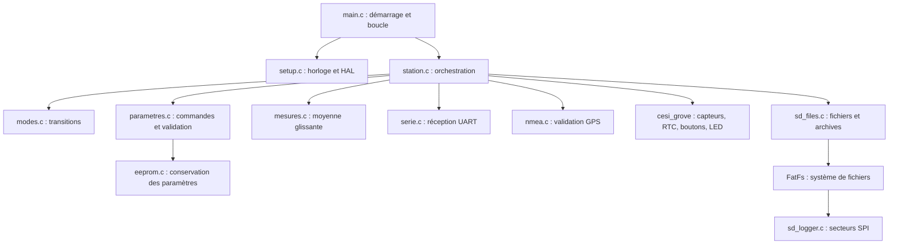

# Livrable 2 - Architecture du programme

Version à figer et à remettre une seule fois. Ce document décrit la structure, les responsabilités et les données ; il ne contient pas le programme final. Le livrable 1 est déjà rendu et n'est pas refait.

## Organisation

Les noms et l'API des pilotes du dépôt CESI sont conservés. Le capteur réellement fourni est un BME280 et la RTC une PCF85063TP ; les pilotes sont adaptés à ces références. Les pilotes Bosch et FatFs restent des bibliothèques matérielles ; la logique du projet est du C avec fonctions, conditions, structures, tableaux, pointeurs et durées mesurées par `HAL_GetTick`.

## Données persistantes en RAM

| Donnée | Contenu | Durée de vie |
|---|---|---|
| `Parametres config` | Intervalle, limite des fichiers, timeout, activations et seuils | Programme entier |
| `Mode mode, precedent` | État de l'automate et mode avant maintenance | Programme entier |
| `Capteur lumi, temp, humidite, pression` | Dix mesures, somme, indice circulaire, nombre de valeurs et erreurs | Programme entier |
| `RTC_DateTime date` | Date et heure validées | Dernier cycle |
| `GPS_Data gps` | Dernière position validée pendant le cycle | Dernier cycle |
| Tampons UART | Octets reçus pendant les transactions matérielles | Programme entier |
| Compteurs et dates de début | Timeout, inactivité, durée des boutons, alternance GPS | Programme entier |

Les données de travail durables sont statiques et ne sont pas recréées sur la pile à chaque boucle. Les petites valeurs locales sont temporaires. La moyenne est mise à jour par adresse avec une somme conservée, sans décaler tout le tableau. Il n'y a pas d'allocation dynamique dans le code écrit pour ce projet.

## Interfaces des modules

| Module | Fonctions principales | Responsabilité |
|---|---|---|
| Station | `station_init`, `station_boucle` | Ordonnancer les opérations |
| Modes | `mode_apres_appui` | Déterminer l'état suivant |
| Paramètres | `parametres_defaut`, `parametres_modifier`, `parametres_valides` | Vérifier toute modification avant application |
| Date | `date_valide`, `regler_rtc` | Vérifier date, heure et jour |
| EEPROM | `parametres_charger`, `parametres_sauver` | Deux copies avec contrôle d'intégrité |
| Mesures | `mesure_ajouter`, `mesure_echouer`, `mesure_moyenne` | Historique et compteur d'erreurs par capteur |
| Série | `serie_init`, `serie_lire`, `serie_debordement` | Séparer réception et interprétation |
| GPS | `nmea_gga` | Vérifier checksum, champs et position |
| SD | `SDLogger_Mount`, `SDLogger_Append`, `SDLogger_Unmount` | Fermer les fichiers après chaque écriture et archiver avant réutilisation |

## Cycle prévu

1. Initialiser les périphériques et charger les paramètres ; à défaut, utiliser les valeurs du sujet.
2. Déterminer le mode initial avec le bouton rouge.
3. À chaque passage, traiter les boutons et la console.
4. Hors configuration, démarrer une acquisition si l'intervalle est écoulé.
5. Réessayer les périphériques manquants jusqu'au timeout, puis produire `NA`.
6. Mettre à jour les structures uniquement avec les mesures valides.
7. Produire une ligne ; l'écrire sur SD en standard/économique si l'horodatage est valide.
8. Afficher la couleur du mode ou du défaut prioritaire.

## Points à faire valider

Le PDF se contredit sur le rouge maintenu cinq secondes en économique. Le choix livré suit le paragraphe économique : rouge retourne au standard. L'autre règle est disponible par une constante de compilation et doit être arrêtée par le tuteur.

Le sujet demande une EEPROM, mais le matériel actuellement identifié n'en comporte pas. L'architecture prévoit une vraie EEPROM externe AT24C32. Le remplacement par un autre support ne fait pas partie de cette version.
