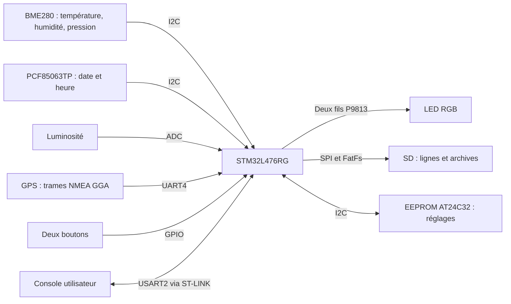

# Livrable 4 - Documentation technique

## Besoin et périmètre

Station embarquée de surveillance météo : température de l'air, humidité, pression, luminosité, GPS, date/heure, quatre modes et conservation des mesures sur SD. Le livrable 1 est déjà rendu. Le sujet précise que les fonctions demandées dans les prosits sont attendues dans le programme : découpage C, compilation automatisée, numéro de build, structures et traitement optimisé des mesures, prise en compte de la pile.

Les modules tiers de température de l'eau, courant, vent et particules sont annoncés pour une intégration ultérieure. Cette version ne simule pas ces modules non fournis.

Le dépôt dérive de l'architecture imposée [ValentinMoraine/Worldwide-Weather-Watcher](https://github.com/ValentinMoraine/Worldwide-Weather-Watcher), commit `3c8fff4c410b22ee1b4ad279ee3a28e06ad8ae67`. Son historique est conservé. Victor ajoutera les membres du groupe comme collaborateurs.

## Flux d'information



## Matériel et brochage

Couper l'alimentation avant de modifier le câblage. Les broches viennent de la base CESI et de la NUCLEO-L476RG.

| Module | Port shield / connexion | Broches STM32 |
|---|---|---|
| BME280 confirmé par identifiant `0x60` | I²C, adresse `0x76` | PB8 SCL, PB9 SDA |
| RTC Grove v2 PCF85063TP confirmée | I²C, adresse `0x51` | PB8 SCL, PB9 SDA |
| EEPROM externe AT24C32 prévue | I²C, adresse `0x50`, A0/A1/A2 à 0, WP à 0 | PB8 SCL, PB9 SDA |
| Luminosité | A2 | PA4, ADC1 canal 9 |
| LED Chainable RGB P9813 | D6 | PB10 horloge, PA8 données |
| Bouton rouge | Première ligne de D2 | PA10, entrée active à 0 |
| Bouton vert | Deuxième ligne de D2 | PB3, entrée active à 0 |
| GPS sur connecteur Grove | A0 | PA0 réception UART4, PA1 émission ; échange RX/TX activé dans UART4 |
| Console ST-LINK | USB ST-LINK de la Nucleo | PA2 USART2 TX, PA3 RX |
| SD CS | D4 | PB5 |
| SD MOSI, MISO, SCK | D11, D12, D13 ; routage à vérifier selon la version du shield | PA7, PA6, PA5 |

Le GPS ne doit pas occuper le connecteur UART du shield relié à la console ST-LINK. La LED embarquée de la Nucleo partage PA5 avec SCK ; elle n'est pas utilisée comme indicateur du programme.

Victor confirme un Seeed Studio SD Card Shield v4.4 (04/01/2022). La [notice Seeed de la famille V4](https://wiki.seeedstudio.com/SD_Card_shield_V4.0/) indique D4 pour CS, D11 pour les données vers la SD, D12 pour les données depuis la SD et D13 pour l'horloge. Si ces signaux sont déjà reliés par les connecteurs empilés, aucun fil supplémentaire n'est nécessaire. L'ordre et l'alignement de l'empilement restent à vérifier sur le montage réel.

Attention au routage réel : le [schéma Eagle constructeur de la v4.3](https://files.seeedstudio.com/wiki/SD_Card_shield_V4.0/res/SD_Card_Shield_v4.3_eagle_file.zip) montre trois sélecteurs à pastilles `DI`, `DO`, `CLK`. Ils choisissent entre les signaux ICSP et D11/D12/D13. Le sujet CESI prévoit des fils depuis ICSP ; la présence de connecteurs Arduino ne prouve donc pas que le SPI y est déjà raccordé. La position de ces sélecteurs sur la v4.4 doit être identifiée physiquement avant de décider si des fils sont nécessaires. Ce contrôle de routage est distinct de l'échec de connexion USB observé même avec le lecteur vide.

Victor confirme un Grove Base Shield **v2.1**. Le [dossier constructeur disponible](https://wiki.seeedstudio.com/Base_Shield_V2/) comporte un circuit imprimé marqué **v2.0, 03/10/2014**. Dans ce schéma, les signaux ICSP MOSI/MISO/SCK du composant U2 ne sont pas reliés aux nets D11/D12/D13. Le connecteur peut transmettre les contacts d'un ICSP situé en dessous ; sur la Nucleo, ce connecteur Arduino n'est pas présent. L'emboîtement du SD sur le Grove ne prouve donc pas à lui seul la liaison SPI avec le microcontrôleur. La continuité réelle sur la v2.1 doit encore être vérifiée : le schéma de la v2.0 n'est pas présenté comme une preuve de cette révision.

Les photos fournies par Victor montrent le connecteur ICSP bleu à six trous sous le shield et les trois sélecteurs DI/DO/CLK. Repérage du connecteur **vu par-dessous, lecteur SD en haut et connecteur ICSP en bas**, comme sur sa deuxième photo :

```text
                    gauche       milieu       droite
rangée du haut      MISO         SCK          non utilisé
rangée du bas       non utilisé  MOSI         non utilisé
```

Pour le profil SPI initial : haut gauche → D12, haut milieu → D13, bas milieu → D11. Ce repérage ne s'applique pas à une vue de dessus : gauche et droite sont inversées. **Correction du 09/10/2026 :** le premier repérage utilisait une autre variante du connecteur incluse dans la bibliothèque Eagle. La variante effectivement sélectionnée pour U2 est `'WITH/-SILK'` : MISO = pastille 33, SCK = 34, MOSI = 37. Ces affectations ont été vérifiées à la fois dans les connexions du schéma et dans les nets du fichier `.brd`. La continuité des sélecteurs de la v4.4 reste à confirmer par mesure ou par un échange SPI réussi.

Pour isoler les contacts mécaniques de l'empilement, un essai à côté de la Nucleo est prévu, USB débranché pendant le câblage. Commencer avec uniquement 5V et GND, sur les longues rangées portant ces inscriptions, sans carte mémoire ; vérifier la connexion USB avant d'ajouter les signaux. Si ce premier essai fonctionne, le raccordement complet externe comporte six fils :

| Support SD | Nucleo / broche accessible sur le shield Grove |
|---|---|
| 5V, rangée marquée 5V | 5V |
| GND, rangée marquée GND | GND |
| ICSP MOSI | D11 |
| ICSP MISO | D12 |
| ICSP SCK | D13 |
| Broche Arduino 4 (CS) | D4 |

Le support SD reste séparé pendant cet essai. Les trois autres broches ICSP ne sont pas raccordées ; leur fonction conventionnelle ne prouve pas qu'elles soient toutes routées sur ce shield. Ne pas employer VIN comme alimentation 5V. Cet essai n'a pas encore été réalisé : il ne prouve pas que le défaut USB est résolu.

Victor possède maintenant quatre adaptateurs Grove vers Dupont femelles. Une [procédure de diagnostic adaptée à ces câbles](TEST_SD_GROVE.md) utilise les ports Grove D2/D4 pour SPI1 et CS, et un troisième câble pour l'alimentation. Elle est réservée au programme `diagnostic_sd_grove`, compilé et téléversé : le programme complet `release` conserve le brochage du tableau initial. Les boutons doivent rester débranchés pendant ce diagnostic car D2/D3 sont alors utilisés par la SD.

**Condition matérielle encore à résoudre :** l'EEPROM externe demandée par le PDF n'a pas été identifiée dans le montage. La version livrée ne remplace pas cette exigence par la SD ou la Flash. Sans EEPROM, les valeurs par défaut sont utilisables, mais les changements de paramètres sont refusés explicitement. Le réglage de la RTC reste possible.

## Architecture et notions du cours

L'architecture est décrite séparément dans [le livrable 2](LIVRABLE_2_ARCHITECTURE.md). `main` initialise, puis exécute une boucle infinie. La logique utilise des fonctions C ordinaires, des énumérations d'états, des conditions, des structures et des tableaux statiques. Les modules accèdent aux structures par pointeur. Il n'y a pas de RTOS ni d'allocation dynamique écrite dans l'application.

Les interruptions UART placent les octets dans deux tampons circulaires statiques de 1024 octets. Elles n'analysent pas les commandes. Un dépassement de tampon provoque l'abandon de la commande ou de la trame, jamais l'application d'une commande tronquée.

Les pilotes Bosch assurent la compensation à partir des coefficients propres au composant. Ces calculs relèvent du pilote matériel. L'application stocke les valeurs utiles en entiers plutôt que de conserver des historiques de flottants.

## Mesures et complexité

Une structure `Capteur` contient dix valeurs `int16_t`, une somme `int32_t`, l'indice de remplacement, le nombre de valeurs présentes et les états d'erreur. Température, humidité et pression sont stockées en dixièmes d'unité ; la luminosité est normalisée entre 0 et 1023 depuis l'ADC 12 bits.

La conversion vérifie la valeur réelle, sa finitude et sa plage avant de passer à l'entier. La moyenne entière est calculée avec les valeurs disponibles, sans zéros artificiels au démarrage. L'addition retire la valeur remplacée et ajoute la nouvelle : **O(1)** par mesure. Une erreur ne modifie pas l'historique ; la sortie courante reste `NA`.

La position GPS garde sa précision géographique ; elle n'utilise pas le type `int16_t` des mesures météo. L'analyse vérifie le checksum, les champs vides, les coordonnées et la qualité du fix. L'affichage est converti en millionièmes de degré et utilise des formats entiers.

## Modes et planification

Au démarrage, rouge sélectionne configuration ; sinon standard. Anti-rebond de trente millisecondes, appuis longs de cinq secondes et un seul changement par maintien. Les durées sont des différences de `uint32_t` pour supporter le rebouclage du compteur système.

Standard : intervalle de dix minutes par défaut, acquisition de tous les capteurs activés. Économique : deux fois l'intervalle, GPS au premier cycle puis un cycle sur deux. Maintenance : cycles rapprochés pour la console et aucune écriture SD. Configuration : aucune acquisition, retour standard après trente minutes sans octet reçu sur la console.

Un cycle attend au maximum `TIMEOUT` pour les périphériques manquants ; les transferts individuels restent courts. La LED et les boutons sont traités entre les essais. Les opérations synchrones I²C/SPI et d'archivage peuvent ajouter de la latence : les timings physiques au pire cas doivent être vérifiés avec le montage final.

## Erreurs

Deux timeouts **consécutifs** déclenchent le défaut d'acquisition ; un succès remet le compteur à zéro. Cette interprétation explicite une règle de remise à zéro que le PDF ne détaille pas. Les incohérences déclenchent immédiatement leur signal. Une humidité refusée uniquement à cause de `HYGR_MINT`/`HYGR_MAXT` est ignorée, sans signaler une panne du capteur.

Les cycles de LED durent une seconde : rouge 500 ms / autre couleur 500 ms, ou rouge 333 ms / autre couleur 667 ms lorsque le PDF exige le double pour l'autre couleur. La priorité des erreurs simultanées est RTC, GPS, capteur inaccessible, incohérence, SD.

Une RTC invalide produit une ligne console horodatée `NA` et empêche l'écriture SD. C'est un choix explicite pour éviter de fabriquer un nom de fichier à partir d'une date inconnue.

## Configuration et EEPROM

Les commandes sont validées intégralement : nom connu, entier strict, domaine et cohérence des seuils. Le candidat est sauvegardé avant de remplacer la configuration active. `RESET` utilise le même mécanisme. Les commandes RTC valident aussi les jours réels des mois et les années bissextiles.

Le pilote EEPROM cible une AT24C32 avec adressage mémoire 16 bits et pages de 32 octets. Deux emplacements de 128 octets contiennent signature, numéro de séquence, paramètres et CRC32. La copie inactive est invalidée, son contenu est écrit, puis la signature est écrite en dernier. Une relecture vérifie la sauvegarde. L'ancienne copie reste disponible si une coupure intervient avant validation de la nouvelle.

Les valeurs et domaines des paramètres sont détaillés dans [le guide utilisateur](LIVRABLE_4_UTILISATEUR.md). Les maxima d'intervalle et de timeout protègent les multiplications de durées ; ils ne sont pas présentés comme des bornes imposées par CESI.

## SD et archivage

Le pilote fourni initialisait le protocole SPI mais sa fonction d'écriture de fichier n'était pas réalisée. `sd_logger.c` est complété par les lectures/écritures de secteurs de 512 octets ; `sd_files.c` appelle FatFs. Les échecs de transfert SPI sont propagés. Initialisation à 312,5 kHz, transferts ensuite à 5 MHz avec le cœur à 80 MHz.

Le fichier actif est toujours `AAMMJJ_0.LOG`. Une ligne reste entière ; l'archivage précède une écriture qui dépasserait la limite. Une copie dans `ARCHIVE.TMP` est fermée, renommée vers la première révision libre, puis le fichier `_0` est tronqué. Les fichiers sont synchronisés et fermés après chaque cycle. Les révisions supérieures à neuf sont autorisées grâce aux noms longs de FatFs, avec tampon statique.

La maintenance démonte le volume. Le retour au mode d'origine remonte la nouvelle carte lors de la prochaine écriture. Aucune commande ne formate la SD. Une coupure électrique pendant une écriture FAT reste un risque ; le mécanisme d'archivage n'est pas un système de fichiers transactionnel.

## Compilation, build et mémoire

```bash
./scripts/projet.sh compile release
./scripts/projet.sh upload release
./scripts/projet.sh compile debug
./scripts/projet.sh monitor
./scripts/projet.sh test
./scripts/projet.sh memoire release
```

Le script détecte PlatformIO dans le PATH ou son installation habituelle. La plateforme est figée à `ststm32@20.0.0`, framework STM32CubeL4. Le script PlatformIO ajoute un numéro de build par environnement à chaque invocation. Version applicative `1.0.0`, lot `CESI-2026`. Le numéro de build se trouve dans `.pio/build/<environnement>/numero-build.txt` et n'est pas partagé comme un numéro universel entre les postes.

`-fstack-usage` produit les cadres estimés par GCC. `scripts/memoire.py` lit les sections de l'ELF et les plus grands cadres. Les historiques et tampons sont statiques, FatFs utilise des buffers statiques pour les noms longs. Le pic réel de pile inclut les appels imbriqués et les interruptions ; les fichiers `.su` ne suffisent pas à certifier ce pic et ne couvrent pas les bibliothèques C précompilées.

Les résultats mesurés de compilation et de tests sont dans `verification/`. Consulter [la validation](VALIDATION.md) pour leur portée exacte.

## Sources et dépendances

- [Sujet CESI](https://scenari.cesi.fr/scenari/cas/IDB_105_CPI_A2_Informatique___S3E_26_27_Septembre_Etudiant_FR/8_-_Projet.html) et [PDF modes](https://scenari.cesi.fr/scenari/cas/IDB_105_CPI_A2_Informatique___S3E_26_27_Septembre_Etudiant_FR/res/A2_-_Projet_Systeme_embarque_-_Modes_de_fonctionnement.pdf), lus depuis les documents disponibles de la formation.
- [BME280 SensorAPI, Bosch](https://github.com/boschsensortec/BME280_SensorAPI), commit `c90d419492e26dd95586598a794e65eb2760753a`, licence incluse.
- [BME68x SensorAPI, Bosch](https://github.com/boschsensortec/BME68x_SensorAPI), commit `80ea120a8b8ac987d7d79eb68a9ed796736be845`, compatibilité du pilote fourni conservée, licence incluse.
- FatFs R0.12c livré avec STM32CubeL4 1.18.2 ; notices de redistribution conservées dans les sources. [Documentation FatFs](https://elm-chan.org/fsw/ff/00index_e.html).
- [Datasheet PCF85063TP, NXP](https://www.nxp.com/docs/en/data-sheet/PCF85063TP.pdf), registres 00h et 04h à 0Ah, et [module Grove v2](https://github.com/Seeed-Studio/Grove_High_Precision_RTC_PCF85063TP).
