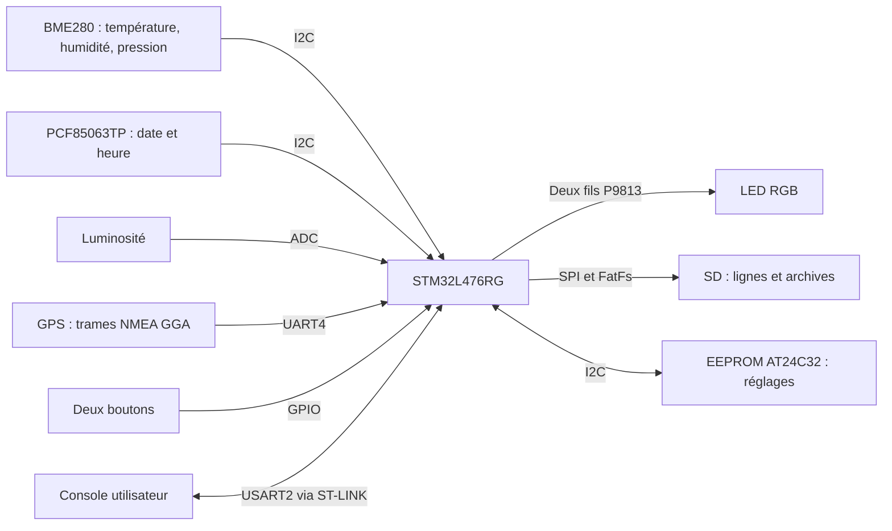

# Livrable 4 - Documentation technique

## Besoin et périmètre

Station embarquée de surveillance météo : température de l'air, humidité, pression, luminosité, GPS, date/heure, quatre modes et conservation des mesures sur SD. Le livrable 1 est déjà rendu. Le sujet précise que les fonctions demandées dans les prosits sont attendues dans le programme : découpage C, compilation automatisée, numéro de build, structures et traitement optimisé des mesures, prise en compte de la pile.

Les modules tiers de température de l'eau, courant, vent et particules sont annoncés pour une intégration ultérieure. Cette version ne simule pas ces modules non fournis.

Le dépôt dérive de l'architecture imposée [ValentinMoraine/Worldwide-Weather-Watcher](https://github.com/ValentinMoraine/Worldwide-Weather-Watcher), commit `3c8fff4c410b22ee1b4ad279ee3a28e06ad8ae67`. Son historique est conservé. Victor ajoutera les membres du groupe comme collaborateurs.

## Flux d'information



## Matériel et brochage

Couper l'alimentation avant de modifier le câblage. Le montage utilise Nucleo → Grove Base Shield v2.1, sélecteur sur **3V3**, avec le lecteur SD posé à côté et trois adaptateurs Grove vers Dupont femelles. Les profils `release`, `debug` et de diagnostic utilisent le même SPI. Les broches sont configurées dans `board_pins.h` et `setup.c`.

| Module | Port shield / connexion | Broches STM32 |
|---|---|---|
| BME280 identifié par `0x60` | I²C, adresse `0x76` | PB8 SCL, PB9 SDA |
| RTC Grove v2 PCF85063TP | I²C, adresse `0x51` | PB8 SCL, PB9 SDA |
| EEPROM externe AT24C32 prévue | I²C, adresse `0x50`, A0/A1/A2 à 0, WP à 0 | PB8 SCL, PB9 SDA |
| Luminosité | A2 | PA4, ADC1 canal 9 |
| LED Chainable RGB P9813 | Entrée IN, alimentation séparée 5V ; signaux D6/D7 | PB10 horloge, PA8 données |
| Bouton rouge | Deuxième ligne de **D8** (D9) | PC7, entrée active à 0 |
| Bouton vert | Première ligne de **D8** (D8) | PA9, entrée active à 0 |
| GPS | A0 | PA0 réception UART4, PA1 émission ; échange RX/TX activé dans UART4 |
| Console ST-LINK | USB ST-LINK de la Nucleo | PA2 USART2 TX, PA3 RX |
| SD CS | Jaune du câble Grove D2 → broche SD 4 | PA10 |
| SD SCK | Blanc du câble Grove D2 → SD SCK | PB3, SPI1 AF5 |
| SD MOSI | Jaune du câble Grove D4 → SD MOSI | PB5, SPI1 AF5 |
| SD MISO | Blanc du câble Grove D4 → SD MISO | PB4, SPI1 AF5 |

Le GPS reste sur A0 et le port UART du Grove reste libre pour la console ST-LINK. Les boutons sont déplacés sur D8 car D2/D3 servent à la SD. Leur initialisation ne modifie pas les GPIO du SPI. La LED embarquée PA5 n'est pas utilisée comme indicateur de la station ; l'indication repose sur le module RGB.

Les capuchons du [Grove Dual Button](https://wiki.seeedstudio.com/Grove-Dual-Button/) sont interchangeables. Sur le module de Victor, l'appui rouge tenu seul a déclenché économique avec l'ancien ordre des signaux : rouge est donc PC7 et vert PA9. Le code associe maintenant ces couleurs aux broches correspondantes. Le port blanc reste D8.

### Alimentation et essai de la LED

La [notice Seeed de la Chainable RGB LED](https://wiki.seeedstudio.com/Grove-Chainable_RGB_LED/) donne une alimentation de **5 V**, y compris pour la version 2 utilisant le P9813S14. L'entrée du module est **IN** (CI/DI), et OUT sert au module suivant. Le branchement direct sur D6 d'un Base Shield réglé sur 3V3, indiqué initialement, ne respecte pas cette alimentation. Le sélecteur Grove reste sur 3V3 pour l'entrée analogique de luminosité.

Un [essai LED séparé](TEST_LED.md) utilise le quatrième adaptateur : rouge sur CN7-18 (+5V), noir sur CN7-20 (GND), jaune horloge sur CN10-25 (PB10), blanc données sur CN10-23 (PA8). Le lecteur SD est déconnecté pour cet essai ; aucun GPIO du programme ne change. Le résultat de l'essai et la distribution commune du 5V avec le lecteur SD restent à valider sur le montage final.

### Alimentation du lecteur SD

Le troisième adaptateur se branche par sa prise blanche dans le port **I²C du lecteur SD**, marqué 5V. Ses bouts rouge et noir vont respectivement sur Nucleo **CN7-18 (+5V)** et **CN7-20 (GND)** ; ses bouts jaune et blanc restent libres. Les rouge/noir des adaptateurs D2/D4 restent libres. Le lecteur reçoit ainsi 5V, tandis que le Base Shield reste sur 3V3 pour les modules et l'entrée analogique. Voir [UM1724, tableau 32](https://www.st.com/resource/en/user_manual/dm00105823.pdf) pour CN7.

### Routage SPI du lecteur

Le Seeed SD Card Shield v4.4 est identifié ; les fichiers disponibles sont ceux de la v4.3. Les sélecteurs DI/DO/CLK de cette famille choisissent ICSP (A) ou les broches latérales Arduino 11/12/13 (B). La [notice Seeed](https://wiki.seeedstudio.com/SD_Card_shield_V4.0/) donne CS = 4, MOSI = 11, MISO = 12 et SCK = 13. Le programme conserve les mêmes GPIO STM32 pour les deux chemins ; seule l'extrémité sur le lecteur change.

Repérage ICSP **vu de dessus, logement SD en haut et bloc de six contacts en bas** :

```text
                    gauche       milieu       droite
rangée du haut      non utilisé  SCK          MISO
rangée du bas       non utilisé  MOSI         non utilisé
```

La variante effectivement sélectionnée pour U2 dans le [fichier Eagle constructeur](https://files.seeedstudio.com/wiki/SD_Card_shield_V4.0/res/SD_Card_Shield_v4.3_eagle_file.zip) est `'WITH/-SILK'` : MISO = pastille 33, SCK = 34, MOSI = 37. La vue par-dessous inverse gauche et droite. Le premier repérage diffusé utilisait une autre variante de la bibliothèque et est corrigé ; le détail des contrôles est conservé dans [la validation](VALIDATION.md).

La [procédure SD](TEST_SD_GROVE.md) précise le câblage et le contrôle GPIO séparé. **État matériel :** le lecteur reste sans réponse CMD0 sur les deux chemins essayés. Une microSD de 8 Go est détectée comme FAT32 et montée par le lecteur du PC. L'écriture depuis la Nucleo n'est pas encore validée ; les sélecteurs et l'alimentation du shield restent à contrôler électriquement. L'accès USB a été rétabli par une réinitialisation ciblée de ST-LINK.

**EEPROM encore à fournir :** l'AT24C32 demandée pour conserver les paramètres n'a pas été identifiée. Le programme ne remplace pas cette exigence par la SD ou la Flash. Sans EEPROM, les valeurs par défaut sont utilisables et les changements de paramètres sont refusés explicitement. Le réglage de la RTC reste possible.

## Architecture et notions du cours

L'architecture est décrite séparément dans [le livrable 2](LIVRABLE_2_ARCHITECTURE.md). `main` initialise, puis exécute une boucle infinie. La logique utilise des fonctions C ordinaires, des énumérations d'états, des conditions, des structures et des tableaux statiques. Les modules accèdent aux structures par pointeur. Il n'y a pas de RTOS ni d'allocation dynamique écrite dans l'application.

Les interruptions UART placent les octets dans deux tampons circulaires statiques de 1024 octets. Elles n'analysent pas les commandes. Un dépassement de tampon provoque l'abandon de la commande ou de la trame, jamais l'application d'une commande tronquée.

Les pilotes Bosch assurent la compensation à partir des coefficients propres au composant. Ces calculs relèvent du pilote matériel. L'application stocke les valeurs utiles en entiers plutôt que de conserver des historiques de flottants.

## Mesures et complexité

Une structure `Capteur` contient dix valeurs `int16_t`, une somme `int32_t`, l'indice de remplacement, le nombre de valeurs présentes et les états d'erreur. Température, humidité et pression sont stockées en dixièmes d'unité ; la luminosité est normalisée entre 0 et 1023 depuis l'ADC 12 bits.

La conversion vérifie la valeur réelle, sa finitude et sa plage avant de passer à l'entier. La moyenne entière est calculée avec les valeurs disponibles, sans zéros artificiels au démarrage. L'addition retire la valeur remplacée et ajoute la nouvelle : **O(1)** par mesure. Une erreur ne modifie pas l'historique ; la sortie courante reste `NA`.

La position GPS garde sa précision géographique ; elle n'utilise pas le type `int16_t` des mesures météo. L'analyse vérifie le checksum, les champs vides, les coordonnées et la qualité du fix. L'affichage est converti en millionièmes de degré et utilise des formats entiers.

## Modes et planification

Au démarrage, rouge sélectionne configuration ; sinon standard. Anti-rebond de trente millisecondes, appuis longs de cinq secondes et un seul changement par maintien. Les durées sont des différences de `uint32_t` pour supporter le rebouclage du compteur système.

Standard : intervalle de dix minutes par défaut, acquisition de tous les capteurs activés. Économique : deux fois l'intervalle, GPS au premier cycle puis un cycle sur deux. Maintenance : cycles rapprochés pour la console et aucune écriture SD. Configuration : aucune acquisition, retour standard après trente minutes sans octet reçu sur la console.

Un cycle attend au maximum `TIMEOUT` pour les périphériques manquants ; les transferts individuels restent courts. La LED et les boutons sont traités entre les essais. Les opérations synchrones I²C/SPI et d'archivage peuvent ajouter de la latence : les timings physiques au pire cas doivent être vérifiés avec le montage final.

## Erreurs

Deux timeouts **consécutifs** déclenchent le défaut d'acquisition ; un succès remet le compteur à zéro. Cette interprétation explicite une règle de remise à zéro que le PDF ne détaille pas. Les incohérences déclenchent immédiatement leur signal. Une humidité refusée uniquement à cause de `HYGR_MINT`/`HYGR_MAXT` est ignorée, sans signaler une panne du capteur.

Les cycles de LED durent une seconde : rouge 500 ms / autre couleur 500 ms, ou rouge 333 ms / autre couleur 667 ms lorsque le PDF exige le double pour l'autre couleur. La priorité des erreurs simultanées est RTC, GPS, capteur inaccessible, incohérence, SD.

Une RTC invalide produit une ligne console horodatée `NA` et empêche l'écriture SD. C'est un choix explicite pour éviter de fabriquer un nom de fichier à partir d'une date inconnue.

## Configuration et EEPROM

Les commandes sont validées intégralement : nom connu, entier strict, domaine et cohérence des seuils. Le candidat est sauvegardé avant de remplacer la configuration active. `RESET` utilise le même mécanisme. Les commandes RTC valident aussi les jours réels des mois et les années bissextiles.

En configuration, le dernier réglage RTC accepté est conservé en RAM. Si la relecture du composant échoue entre DATE, DAY et CLOCK, la commande suivante repart de ce réglage au lieu d'effacer la date précédente. Au premier réglage d'une RTC illisible, une base 2000-01-01 permet d'envoyer les trois commandes successives. Cette mémoire de travail est remise à zéro au démarrage et ne fournit jamais l'horodatage des mesures : celles-ci exigent une vraie lecture valide de la RTC.

Le pilote EEPROM cible une AT24C32 avec adressage mémoire 16 bits et pages de 32 octets. Deux emplacements de 128 octets contiennent signature, numéro de séquence, paramètres et CRC32. La copie inactive est invalidée, son contenu est écrit, puis la signature est écrite en dernier. Une relecture vérifie la sauvegarde. L'ancienne copie reste disponible si une coupure intervient avant validation de la nouvelle.

Les valeurs et domaines des paramètres sont détaillés dans [le guide utilisateur](LIVRABLE_4_UTILISATEUR.md). Les maxima d'intervalle et de timeout protègent les multiplications de durées ; ils ne sont pas présentés comme des bornes imposées par CESI.

## SD et archivage

Le pilote fourni initialisait le protocole SPI mais sa fonction d'écriture de fichier n'était pas réalisée. `sd_logger.c` est complété par les lectures/écritures de secteurs de 512 octets ; `sd_files.c` appelle FatFs. Les échecs de transfert SPI sont propagés. Initialisation à 312,5 kHz, transferts ensuite à 5 MHz avec le cœur à 80 MHz.

Le fichier actif est toujours `AAMMJJ_0.LOG`. Une ligne reste entière ; l'archivage précède une écriture qui dépasserait la limite. Une copie dans `ARCHIVE.TMP` est fermée, renommée vers la première révision libre, puis le fichier `_0` est tronqué. Les fichiers sont synchronisés et fermés après chaque cycle. Les révisions supérieures à neuf sont autorisées grâce aux noms longs de FatFs, avec tampon statique.

La maintenance démonte le volume. Le retour au mode d'origine remonte la nouvelle carte lors de la prochaine écriture. Aucune commande ne formate la SD. Une coupure électrique pendant une écriture FAT reste un risque ; le mécanisme d'archivage n'est pas un système de fichiers transactionnel.

## Compilation, build et mémoire

```bash
./scripts/projet.sh compile release
./scripts/projet.sh upload release
./scripts/projet.sh compile debug
./scripts/projet.sh monitor
./scripts/projet.sh test
./scripts/projet.sh memoire release
```

Le script détecte PlatformIO dans le PATH ou son installation habituelle. La plateforme est figée à `ststm32@20.0.0`, framework STM32CubeL4. Le script PlatformIO ajoute un numéro de build par environnement à chaque invocation. Version applicative `1.0.0`, lot `CESI-2026`. Le numéro de build se trouve dans `.pio/build/<environnement>/numero-build.txt` et n'est pas partagé comme un numéro universel entre les postes.

`-fstack-usage` produit les cadres estimés par GCC. `scripts/memoire.py` lit les sections de l'ELF et les plus grands cadres. Les historiques et tampons sont statiques, FatFs utilise des buffers statiques pour les noms longs. Le pic réel de pile inclut les appels imbriqués et les interruptions ; les fichiers `.su` ne suffisent pas à certifier ce pic et ne couvrent pas les bibliothèques C précompilées.

Les résultats mesurés de compilation et de tests sont dans `verification/`. Consulter [la validation](VALIDATION.md) pour leur portée exacte.

## Sources et dépendances

- [Sujet CESI](https://scenari.cesi.fr/scenari/cas/IDB_105_CPI_A2_Informatique___S3E_26_27_Septembre_Etudiant_FR/8_-_Projet.html) et [PDF modes](https://scenari.cesi.fr/scenari/cas/IDB_105_CPI_A2_Informatique___S3E_26_27_Septembre_Etudiant_FR/res/A2_-_Projet_Systeme_embarque_-_Modes_de_fonctionnement.pdf), lus depuis les documents disponibles de la formation.
- [BME280 SensorAPI, Bosch](https://github.com/boschsensortec/BME280_SensorAPI), commit `c90d419492e26dd95586598a794e65eb2760753a`, licence incluse.
- [BME68x SensorAPI, Bosch](https://github.com/boschsensortec/BME68x_SensorAPI), commit `80ea120a8b8ac987d7d79eb68a9ed796736be845`, compatibilité du pilote fourni conservée, licence incluse.
- FatFs R0.12c livré avec STM32CubeL4 1.18.2 ; notices de redistribution conservées dans les sources. [Documentation FatFs](https://elm-chan.org/fsw/ff/00index_e.html).
- [Datasheet PCF85063TP, NXP](https://www.nxp.com/docs/en/data-sheet/PCF85063TP.pdf), registres 00h et 04h à 0Ah, et [module Grove v2](https://github.com/Seeed-Studio/Grove_High_Precision_RTC_PCF85063TP).
